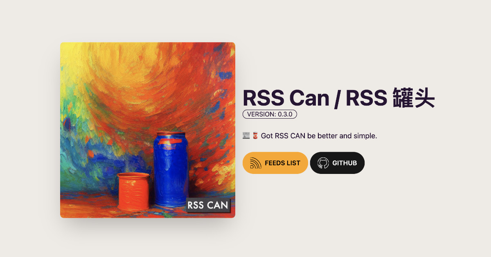
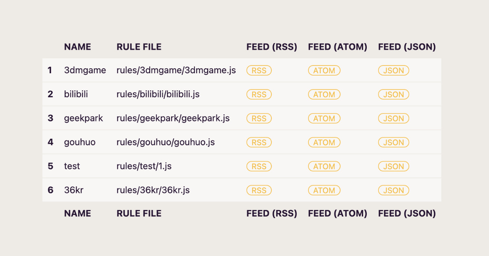

# RSS Can / RSS 罐头

[](./.github/go-test-report.md) [](./.github/goreportcard-report.md) [](https://github.com/soulteary/RSS-Can/actions/workflows/codeql.yml) [](https://github.com/soulteary/rss-can/actions/workflows/build.yml) [](https://hub.docker.com/r/soulteary/rss-can)

<p style="text-align: center;">
  <a href="README.md" target="_blank">ENGLISH</a> | <a href="README_CN.md">中文文档</a>
</p>

📰 🥫 **借助 AI 模型能力，做更好的 RSS 解决方案**

<p style="text-align: center;">
  
</p>

<p style="text-align: center;">
  
</p>

## 支持软硬件环境

- Linux: AMD64(x86_64) / ARM64
- macOS: AMD64(x86_64) /  ARMv64

当前版本：[v0.3.12](https://github.com/soulteary/rss-can/releases/tag/v0.3.12)。变更和升级须知见[发布说明](docs/releases/v0.3.12.md)。

## 使用方法

从 GitHub 的软件发布页面，[下载软件](https://github.com/soulteary/RSS-Can/releases)之后，直接运行就可以啦：

```bash
./rssc
```

### 源码构建的 JavaScript 运行时

源码构建现已默认使用常驻 Deno worker。请先安装 [Deno](https://docs.deno.com/runtime/getting_started/installation/) **2.9.8** 并加入 PATH，或用 `RSS_CAN_DENO` 指定可执行文件。使用 `CGO_ENABLED=0 go build -o rssc .` 构建，无需构建标签；运行测试也需要 Deno。更新后的 Docker 构建会内置 Deno，独立发行包需单独安装。已发布的 v0.3.12 二进制和镜像仍使用原来的运行时。

服务启动时会检查 Deno 是否可用。生命周期与部署要求见[运行时说明](docs/deno-prototype.md)。

### Docker 容器方式运行

使用下面的命令，下载最新版本的软件之后，使用 `docker run` 运行即可（记得将项目中的 Feed Rules 挂载到容器中）：

```
docker pull soulteary/rss-can:v0.3.12
docker run --rm -it -p 8080:8080 -v `pwd`/rules:/rules soulteary/rss-can:v0.3.12
```


Docker Hub 镜像支持 Linux AMD64/ARM64。镜像已包含示例规则；仅使用内存缓存时添加 `-e RSS_REDIS=false`。二进制归档包含 `rssc`、`rules/`、文档和许可证，可使用随附的 SHA-256 文件校验。

### 支持的命令行参数及环境变量

**所有的参数都是可选使用，根据自己的实际需要来即可。**

想要获取程序支持的参数，可以通过在执行程序后添加参数 `-h` 或者 `--help`：
 
```bash
Usage of rssc:
  -debug RSS_DEBUG
    	whether to output debugging logging, env: RSS_DEBUG
  -debug-level RSS_DEBUG_LEVEL
    	set debug log printing level, env: RSS_DEBUG_LEVEL (default "info")
  -feed-path RSS_HTTP_FEED_PATH
    	http feed path, env: RSS_HTTP_FEED_PATH (default "/feed")
  -headless-addr RSS_HEADLESS_SERVER
    	set Headless server address, env: RSS_HEADLESS_SERVER (default "127.0.0.1:9222")
  -headless-slow-motion RSS_HEADLESS_SLOW_MOTION
    	set Headless slow motion, env: RSS_HEADLESS_SLOW_MOTION (default 2)
  -host RSS_HOST
    	web service listening address, env: RSS_HOST (default "0.0.0.0")
  -memory RSS_MEMORY
    	using Memory(build-in) as a cache service, env: RSS_MEMORY (default true)
  -memory-expiration RSS_MEMORY_EXPIRATION
    	set Memory cache expiration, env: RSS_MEMORY_EXPIRATION (default 600)
  -port RSS_PORT
    	web service listening port, env: RSS_PORT (default 8080)
  -proxy RSS_PROXY
    	Proxy, env: RSS_PROXY
  -redis RSS_REDIS
    	using Redis as a cache service, env: RSS_REDIS (default true)
  -redis-addr RSS_SERVER
    	set Redis server address, env: RSS_SERVER (default "127.0.0.1:6379")
  -redis-db RSS_REDIS_DB
    	set Redis db, env: RSS_REDIS_DB
  -redis-pass RSS_REDIS_PASSWD
    	set Redis password, env: RSS_REDIS_PASSWD
  -rod string
    	Set the default value of options used by rod.
  -rule RSS_RULE
    	set Rule directory, env: RSS_RULE (default "./rules")
  -timeout-headless RSS_HEADLESS_EXEC_TIMEOUT
    	set headless execution timeout, env: RSS_HEADLESS_EXEC_TIMEOUT (default 5)
  -timeout-js RSS_JS_EXEC_TIMEOUT
    	set js sandbox code execution timeout, env: RSS_JS_EXEC_TIMEOUT (default 200)
  -timeout-request RSS_REQUEST_TIMEOUT
    	set request timeout, env: RSS_REQUEST_TIMEOUT (default 5)
  -timeout-server RSS_SERVER_TIMEOUT
    	set web server response timeout, env: RSS_SERVER_TIMEOUT (default 8)
```

### 管理接口与页面检查工具

`/config/*` 和 `/inspector*` 默认仅接受直接来自本机回环地址、且使用 `localhost` 或回环 IP 作为 Host 的请求。反向代理转发的请求需要配置 `RSS_ADMIN_TOKEN`，并在请求中提供 `Authorization: Bearer <token>`。配置 token 后，本机请求也需要认证；浏览器使用这些工具时，可由已认证的反向代理注入该请求头。跨站请求不允许调用管理接口。

页面检查工具仅访问公网 HTTP(S) 目标；重定向和子资源同样受到限制，不支持内网地址、Cookie 或代理转发。抓取的页面在独立沙箱中显示。普通订阅抓取仍可使用规则中的 Cookie 和代理配置。

浏览器任务最多同时执行 4 个，超时包括排队、连接、导航和脚本执行。每次任务使用独立浏览器上下文，并在完成或失败后释放。CSR、混合模式和 SSR 使用隔离的缓存；规则内容或 Cookie 改变后不会复用原有 CSR 缓存。

依赖版本、升级约束和内嵌脚本来源见[依赖维护说明](DEPENDENCIES.md)。

### 运行回归测试

测试需要可用的 Redis；浏览器集成测试使用本机安装的 Chrome / Chromium，不会自动下载浏览器：

```bash
RSS_SERVER=127.0.0.1:6379 RSS_TEST_BROWSER_REQUIRED=1 go test -race ./... -count=1
```

可通过 `RSS_TEST_CHROME` 指定浏览器二进制路径。未安装浏览器时，默认跳过浏览器集成测试；设置 `RSS_TEST_BROWSER_REQUIRED=1` 则将缺少浏览器视为失败。Redis 地址可通过 `RSS_SERVER` 指定。缓存连接配置在进程启动后固定，修改后需要重启。

## 里程碑

- [支持使用 CSR 解析模式处理数据](https://github.com/soulteary/rss-can/issues/15), [Blog](https://soulteary.com/2022/12/15/rsscan-use-golang-rod-to-parse-the-content-dynamically-rendered-in-the-browser-part-4.html)
- [支持将网站数据转换为可订阅的 RSS 订阅源](https://github.com/soulteary/rss-can/issues/14), [Blog](https://soulteary.com/2022/12/14/rsscan-convert-website-information-stream-to-rss-feed-part-3.html)
- [支持“动态化”能力](https://github.com/soulteary/rss-can/issues/13), [Blog](https://soulteary.com/2022/12/13/rsscan-make-golang-applications-with-v8-part-2.html)
- [支持自动解析目标网站的网页编码格式，支持混合解析模式，提供比 CSR 解析模式更快的处理速度，支持从其他页面抽取数据装填 RSS 列表页面数据](https://github.com/soulteary/rss-can/issues/11)
- [支持使用 SSR 解析模式处理数据](https://github.com/soulteary/rss-can/issues/12), [Blog](https://soulteary.com/2022/12/12/rsscan-better-rsshub-service-build-with-golang-part-1.html)
- [支持使用 Redis 和 应用内存 作为数据缓存，避免大量不必要的网络请求造成的麻烦，支持动态加载 RSS 规则文件](https://github.com/soulteary/rss-can/issues/10)
- [支持跨多个页面聚合信息为 RSS 订阅源，完成第一个版本的 JS SDK，发布，支持 Docker 镜像](https://github.com/soulteary/rss-can/issues/9)
- [程序支持参数化调用，发布版本；支持简单的 Web UI，以及新的参数，发布版本](https://github.com/soulteary/rss-can/issues/8)

## 项目计划

- [ ] 文档: 提供简单的教程和文档，阐述如何使用常见技术栈来玩转 RSS Can。 [#16](https://github.com/soulteary/rss-can/issues/16)
- [ ] Pipeline: 支持 RSS 信息流水线，能够定制信息处理任务，以及提供集成到各种开源软件的能力。
- [ ] AI: NLP 任务的集成和使用。
- [ ] 规则: 能够将社区两款软件的规则导入程序： [rss-bridge](https://github.com/RSS-Bridge/rss-bridge/tree/master/bridges) / [RSSHub](https://github.com/DIYgod/RSSHub/tree/master/lib)
- [ ] 工具: 支持通过界面工具快速生成规则，或参考: [damoeb/rss-proxy](https://github.com/damoeb/rss-proxy)


## License & Credits

This project is licensed under the [MIT License](https://github.com/soulteary/RSS-Can/blob/main/LICENSE)

项目的快速进化离不开下面优秀的开源软件，你可以点击这个链接，了解它们是谁：[Credits](./CREDITS.md)
